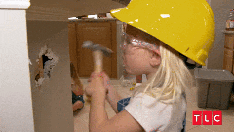

  

<h1 align="center">Who I am when I am not working</h1>

I'm **Rohan Desai**.  
I like systems that stay up, tools that feel kind, and ideas that can be visualized.

- Site: [rohandesai.in](https://rohandesai.in)
- LinkedIn: [rohandesai01](https://www.linkedin.com/in/rohandesai01/)
- Email: [pro.rohandesai@gmail.com](mailto:pro.rohandesai@gmail.com)

---

  

### Side Projects

Hey. This is my little corner of the internet for things I build **for myself**.

Not the day job. Not client work. Just the ideas I chase because they make me curious, happy, or slightly obsessed.

This whole repository is that corner: **my entire side-work home**, one place for the non-official things I made in my own time.

Even the live projects aren’t fully secured by design 😅 I know cloud security pretty well, but there’s no point paying 24/7 for heavy protection when basically no one uses these sites except me haha. The basics are covered though!

---

### What's here

The public projects and their files are in [`apps/portfolio/projects/`](apps/portfolio/projects/). The easiest way to explore their code is through the [projects page](https://rohandesai.in/projects), where you can open each project and browse its files.

The projects page also lists work whose code is private and isn't kept in this repository. Some of those websites are open for anyone to view. Others have private code and private websites; if you'd like to see one, [email me](mailto:pro.rohandesai@gmail.com) to ask for access.

---

### What's next

Honestly, probably nothing new. Project “Annara” is planned, but it’s postponed indefinitely since it needs more people, money, time, and compute that I cannot manage alone. I still have ideas, but I don’t think I’ll be building new personal projects anymore. I’ll just rarely tweak the existing ones and keep adding data to the live platforms.

  

---

### A soft note

Everything here was inspired by ideas that popped into my own head. I had the urge to visualize them and built those things on my own. I'm a DevOps / Infrastructure / Reliability engineer, so shipping full web apps (frontend, backend, and the rest) sits outside my usual craft; AI was used for that part in several projects (if you find any dashes then close your eyes hehe).

If something speaks to you, I am glad it found you.  
If you want to talk about any of it, my door is open.

See ya.

  

